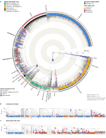

Telomeres cap the ends of chromosomes, and in most eukaryotes they are a short DNA repeat laid down by telomerase. Telomerase has two core parts: a protein, TERT, and an RNA (the TR) that carries a short template for the repeat. Change the template and you change the repeat.

We have now surveyed all three across 3,422 chromosome-level genomes from the [Darwin Tree of Life](https://www.darwintreeoflife.org/), and the results are online as a [telomeric repeat database](/telomeres.html).

<figure class="post-fig">
  
  <figcaption><b>a</b>, the dated species tree, with rings (inside to out) for the telomeric repeat, a validated TR and TERT. Symbols mark each change of repeat, by route. <b>b</b>, <b>c</b>, beetles (Coleoptera) and Hymenoptera enlarged, where most changes are. Click for the full-size figure, or explore it on the <a href="/telomeres.html">database page</a>, where you can hover over any species or change.</figcaption>
</figure>

For each species you can see:

- **The telomere**: the repeat called by [tidk](https://github.com/tolkit/telomeric-identifier), and how many chromosome ends carry it.
- **The telomerase RNA**: the TR locus, with its template marked, and whether the template encodes the same repeat that is at the chromosome ends.
- **TERT**: the gene, as coding sequence and protein.

All of it is free to download, one species at a time or in bulk as FASTA and a single table. Hover over any call to see what it means, or why a TR was not validated. The dated tree of all 3,422 species is on the page too, with every change of telomeric repeat marked on its branch.

A few things stand out:

- **Three repeats cover most of the tree**: `AACCT` in 1,212 species (mostly arthropods), `AAACCCT` in 705 (plants) and `AACCCT` in 427 (most other animals). Altogether we found 80 different repeats.
- **The TR is hard to find, but we found many**: 1,957 genomes have a validated TR, where the template matches the repeat at the chromosome ends. TRs evolve so fast that relatives often barely align.
- **Telomerase has been lost twelve times**. The biggest loss is in the true flies, where none of the 402 species in our data has TERT, and their chromosome ends are maintained some other way.

Try the hoverfly [*Merodon equestris*](/telomeres.html#Merodon_equestris), whose lineage lost telomerase 280 to 290 million years ago, or the bumblebee [*Bombus terrestris*](/telomeres.html#Bombus_terrestris), with its unusual 11-base repeat.

These data are in preparation for a paper, where we look at TR and TERT losses, rates of repeat change and how they vary across the phylogeny. If you would like to use them before then, please [get in touch](/contact.html).
